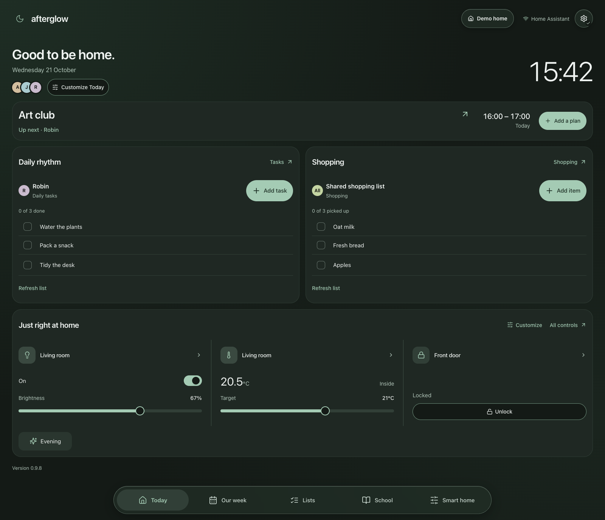
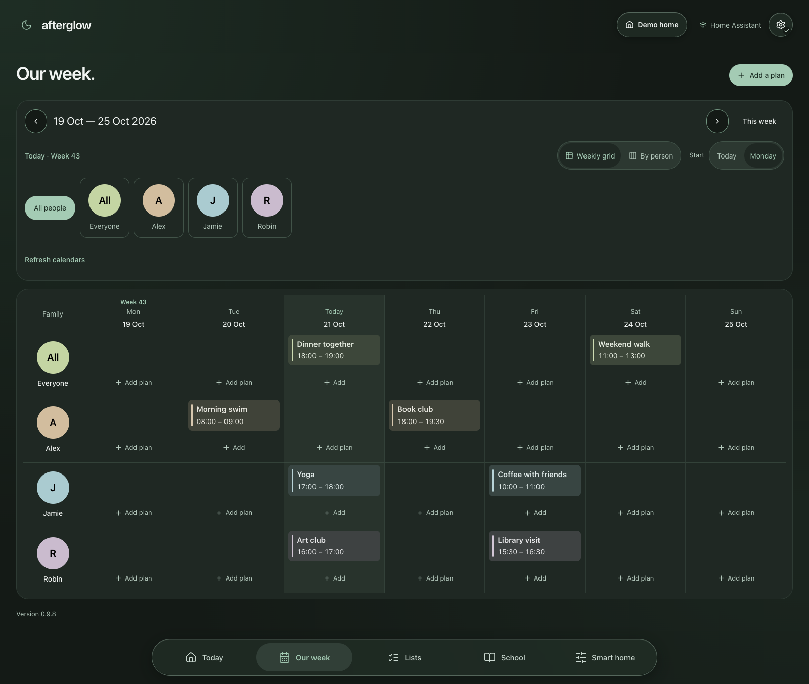

# Home Harmony UI

**Afterglow** brings your family’s calendars, lists, school timetables and Home Assistant controls onto one shared dashboard.



*Example dashboard with fictional data.*

## At a glance

- **Plan together** — a family calendar, daily tasks, family tasks filtered by person avatar, and shared shopping lists with individual icons.
- **Keep school close** — PDF timetables or Home Assistant calendars, with iPhone uploads. Enable **Homework** under **Customize Today** to see unfinished homework due by today or tomorrow. These two periods include overdue work. A separate switch includes undated homework by default. Check it off on the board or choose a shortcut to Lists or School.
- **Control your home** — lights, climate, scenes and other Home Assistant devices.
- **Ask the house** — type a question or command for Home Assistant Assist from the header, such as “Which lights are on?”, and read the answer. Turn it on under **Settings → Screen and alerts → Assist**; what Assist may control is set in Home Assistant.
- **Know when power is cheap** — **Car & energy** leads with what uses power now and, with a price sensor such as Nord Pool, shows today’s prices and the cheapest three hours.
- **Listen together** — a dedicated Sonos player with grouped room selection and a shared music library in **Your music**. Open group and speaker settings when needed; keep your library folder and filter when switching rooms.
- **Share across screens** — one server keeps preferences and timetables in sync. English and Norwegian Bokmål, light and dark themes.

Home Assistant owns your people, events, lists and devices. Afterglow stores dashboard preferences and uploaded timetables; the HA token stays on the server.

Away from Today, the header shows the time and date (just the time on phones) and, with **Settings → Weather → Beside the clock**, the current weather beside it.

Use the settings cog on Today (I dag) to show, hide or reorder sections with the up/down arrows and to make most sections **Full** or **Half** width. Two half sections next to each other in the order sit side by side on wide screens, and a small preview at the top of the dialog shows the resulting rows; phones always stack. Everyone’s day, Everyone’s week and School always use the full width. **Free space on the wall** lets one list-like section, such as Latest events, grow down to the navigation on the large portrait screen and show as many rows as fit; it is off by default. The header gear opens Settings directly. Choose **Continue setup** to resume at the next missing step, or expand **Household**, **Screen and alerts**, **Devices** or **System** for a specific setting. Order, widths and the fill choice are saved across screens and included in backups. **Reset order and widths** restores the original order and widths without changing visibility.

**Latest events** (Siste hendelser) on Smart home reads like a household diary: “Garage door opened”, “Dishwasher finished”, “Robot vacuum docked”, updated live from the Home Assistant logbook. Turn on **Customize Today → Latest events** to show the same panel on Today as well. **Settings → System → Activity** shows the full log for today or yesterday, filtered by area and type, and chooses the panel’s sources and which event types the panel and the log show. People coming and going stay out unless you include them.

**Settings → System → Home Assistant health** shows repairs, Home Assistant's notifications (with **Dismiss**), automatic backup status and waiting updates, so the owner rarely needs to open Home Assistant for housekeeping. Only problems that need action, such as a failed or overdue backup or an error-level repair, reach the family's **Home status** and a count on the Settings menu. Backup status needs an administrator token; repairs and notifications work with any Home Assistant user. [Details →](DOCS.md#home-assistant-health)

Automations, Integrations and Activity live under **Settings → System**, away from the Smart home navigation the family uses every day. Turning an automation off or running its actions asks for confirmation first. Old links to `/automations`, `/integrations`, `/services` and `/history` open the matching Settings section. On phones, Smart home destinations that do not fit fade out at the edge of their scrolling row, with **More** at the right.

Home favorites on Today reuse Smart home's compact device cards. Both views update a card when its main or supporting entity changes and skip rendering it for unrelated entity state updates. In **Make home yours**, browse a three-column grid of visual card types with vertical scrolling, choose matching entities and save your favorites. Create names in the **Card groups** section, then choose a group from each card’s searchable dropdown to show related cards under a heading on Today. Choose **Ungrouped** to leave a card outside the groups; empty groups are saved for later use. Existing choices stay selected across types and appear as visual card previews below the separate glass catalogue. Groups and favorites save together, sync across screens and are included in backups. Super compact scene cards use a large, full-width glass activation button with the scene name inside. Scene cards do not link to device details; activation still asks for confirmation.

Under **Settings → Devices → Electric vehicles**, select **Add electric vehicle** and choose the car’s source. Each added car has its own card. Choose **TeslaMate** for MQTT readings. To control the cabin from the same widget, open **Edit** on the car and use **Send commands for … through** to choose the matching car from your Tesla integration. Each car can also use TeslaMate alone or a Tesla integration alone. Each compact widget places the car photo beside its battery percentage, drive state, fan, charging or plug icon and battery gauge. The widget and the overview beside the car photo follow the car from parked or driving into sleep and back. Open the car to check cabin temperature, locks, openings, position and arrival time. The map follows the car and shows its reported speed, gear and heading. Vehicle position shows the Home Assistant zone or the car’s address. Choose **Show map fullscreen** for a larger view. Cars with a climate control also let you adjust it. Dedicated views cover charging, cabin and seats, security, trips, tyre pressure and service.

Under **Settings → Screen and alerts → Appearance**, adjust dialog transparency, frost, color saturation and background dimming with a live preview. Dialogs use a lighter glass fill by default; accessibility preferences retain solid surfaces. Glass settings are shared across screens and included in backups.

Under **Artwork**, choose from eleven wall backgrounds. Fjord Morning, Winter Garden, Sunroom, Paper Coast and Northern Lights are joined by Harbor Light, Birch Grove, Star Atlas, Pottery Studio, Wildflower Meadow and Woven Hills. **No artwork** keeps the original ambient background.

Under **Card artwork**, turn on a corner illustration and matching heading icon for individual planner types, such as Homework or Calendar. Expand **Smart home cards** to select individual configured cards, even when two use the same device. Card illustrations work with any wall background, including No artwork. All artwork follows your palette and light or dark mode, syncs across screens and is included in configuration backups.

Unfinished to-dos with due dates appear under their assigned person in the month, week and day calendars, including Today’s calendar previews. A small task icon distinguishes them from calendar events. Date-only deadlines appear as all-day items; timed deadlines use the home’s time zone. Choose **Open to-do list** in a dated task to open its assigned list. The calendar excludes completed tasks, undated tasks and shopping items.

Calendar and Everyone’s day keep their last loaded plans during background refreshes and temporary connection failures. Today, Calendar and School reuse their calendar calculations when unrelated Home Assistant sensors update. The weekly grids on Today and Calendar also skip rendering for those updates, including while either page is in the background. Loading text is reserved for the first fetch; connection errors still appear. Changing the selected home, calendar sources or date range clears unrelated cached calendar data. This cache lives only in memory.

The shared board shows household facts, not setup gaps. Everyone’s day leaves out people with no calendar or to-do list selected (showing everyone only when nobody has one yet), and labels an empty day **Free**. The header’s **Home status** button opens household readings grouped by function. The overview shows the result and any exceptions. **View readings** opens the source details, and **Manage sources** offers ten categories for connecting devices. Defaults include the selected alarm, smoke detectors assigned to an area and their low-battery signals. Turn on **Customize Today → Home status** for a card that appears when a selected source needs attention. A connected home shows only the Lists tabs that have lists selected. Next family plan shows the activity, person, time and countdown. **Open calendar** takes you to that day. A missing timetable links straight to Settings → Household → Timetables.

Next family plan summarizes timed plans. All-day events remain visible in the day and week views. The card shows formatted descriptions beneath the event. Its heading chevron expands or collapses the description without opening the calendar dialog. Under **Customize Today → Next family plan**, **Hide description by default** chooses the initial state; descriptions stay visible by default for existing setups. This preference syncs across screens and is included in backups. Manual toggles apply only on this screen to the current event; the next event or a changed default uses the saved preference. Events without descriptions have no chevron.

Today, Calendar, Lists, School and Smart home preload shortly after startup and stay mounted while you navigate. Their loaded data, filters and drafts remain in memory, and the main navigation remembers the selected calendar date, view, list tab and list. Background pages keep receiving data updates while dialogs are hidden and camera streams pause. Reloading clears in-memory drafts. The current URL retains a directly selected date, view or list.

Bring! shopping lists show their urgent item count when positive. On a compatible Dreame vacuum card, choose **Choose rooms**, check one or more rooms on the current robot map, then start cleaning the selection.

3D printers from the Bambu Lab integration get their own **3D printer** card on Smart home. Under **Settings → Devices → Smart home**, choose **Add card**, pick **3D printer** and select the printer's progress, status or stage sensor; the rest of the printer is found automatically, including filament units connected to it. The card leads with progress and time left, then shows the stage, nozzle and bed temperatures and the loaded filament colours. The Original size adds the printer camera while a print runs and the model's cover image otherwise. A finished print shows when it was done, a failed print shows the printer's error text, and an offline printer says so instead of showing old readings. The printer's device page opens with the same card; its chamber light keeps its normal light control. The card only reads the printer and cannot start, pause or stop a print. Other printer integrations can be added as a second key map in `src/lib/printer-model.ts`.

## Get started

### Home Assistant OS

1. Add `https://github.com/cskogstrand/home-harmony-ui` to your app/add-on repositories and install **Home Harmony UI**.
2. In **Configuration**, set `home_assistant_url`, `home_assistant_token` (a long-lived access token) and `dashboard_password` (at least 12 characters).
3. Start the app and open its web interface on port **8099**. Sign in as **dashboard** with your dashboard password.
4. Open **Get started** on Today. Connect Home Assistant, choose who appears on the board and assign calendars and lists in the guide. Use the same dashboard address on your other screens.

[Full installation and connection help →](https://github.com/cskogstrand/home-harmony-ui/blob/main/DOCS.md#haos-app-installation)

### Docker

```sh
cp .env.example .env
# Set the Home Assistant URL, token and dashboard password in .env.
docker compose up --build -d
```

Open port **8099** on the Docker host and sign in as above. Settings and uploads live in `./data`; back up that entire folder. [Docker details →](https://github.com/cskogstrand/home-harmony-ui/blob/main/DOCS.md#manual-docker-deployment)

Use a trusted LAN/VPN or an HTTPS reverse proxy. Anyone with dashboard access can use the configured HA account’s controls.

## A week at a glance



## Go deeper

| Guide | What’s inside |
| --- | --- |
| [Setup and everyday use](https://github.com/cskogstrand/home-harmony-ui/blob/main/DOCS.md) | Installation, connection help, preferences, backups, timetables and iPhone uploads |
| [Morning summaries](https://github.com/cskogstrand/home-harmony-ui/blob/main/docs/morning-summary.md) | Optional Home Assistant automation, phone notifications and spoken summaries |
| [Notifications](https://github.com/cskogstrand/home-harmony-ui/blob/main/docs/notifications.md) | Ongoing tasks, state and calendar alerts, and doorbell camera popups |
| [Cameras](https://github.com/cskogstrand/home-harmony-ui/blob/main/docs/cameras.md) | Named cameras, reusable connections, live video and person snapshots for notifications |
| [Sonos](https://github.com/cskogstrand/home-harmony-ui/blob/main/docs/sonos.md) | Playback, grouped rooms, volume, favorites, playlists, queues and sound settings |
| [Development and releases](https://github.com/cskogstrand/home-harmony-ui/blob/main/docs/development.md) | Node 24+ setup, verification commands and image publishing |

For local development, configure `.env` as above, then run `npm ci` and `npm run dev`. Open port **8080**. PDF conversion also needs [Poppler](https://github.com/cskogstrand/home-harmony-ui/blob/main/docs/development.md#local-development-and-node-deployment).
