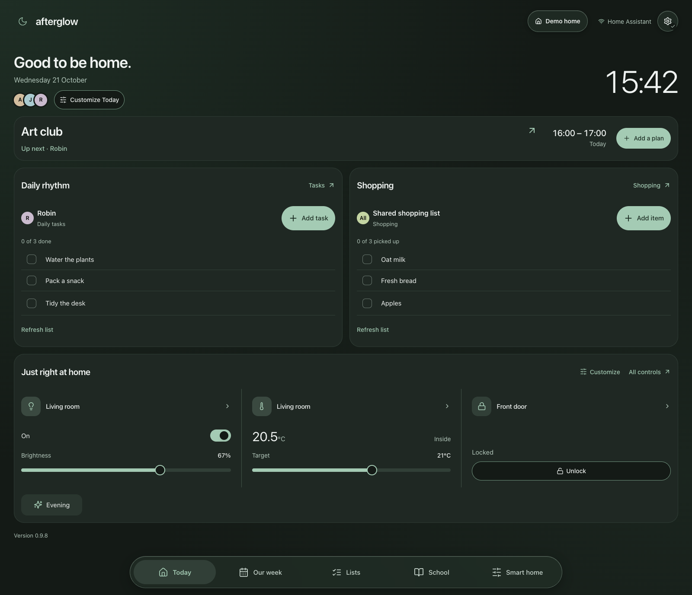
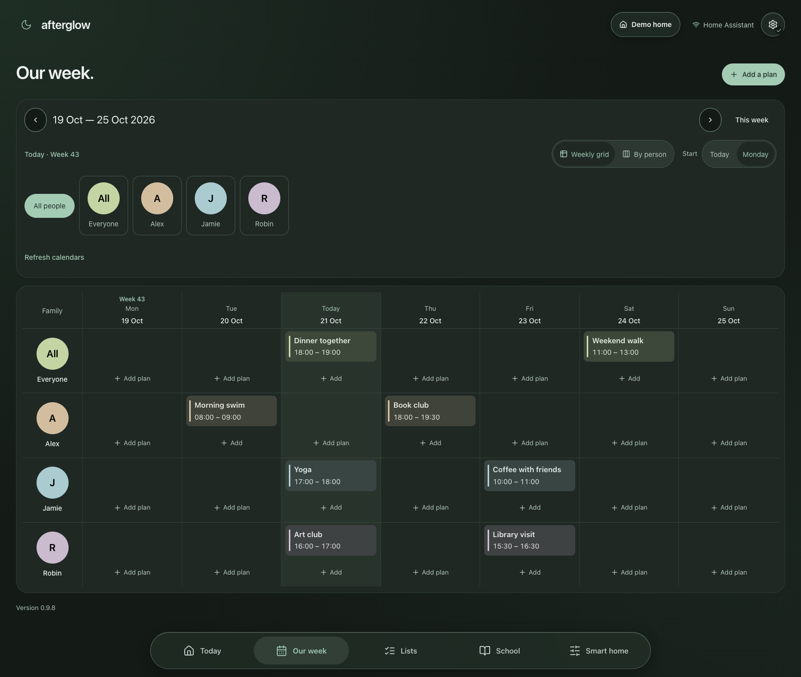

# Home Harmony UI

**Afterglow** brings your family’s calendars, lists, school timetables and Home Assistant controls onto one shared dashboard.



*Current app with fictional demo data.*

## At a glance

- **Plan together** — a family calendar, daily tasks and a shared shopping list.
- **Keep school close** — PDF timetables or Home Assistant calendars, with iPhone uploads.
- **Control your home** — lights, climate, scenes and other Home Assistant devices.
- **Listen together** — a dedicated Sonos page with playback, room grouping, group and room volume, favorites, playlists and queue controls.
- **Share across screens** — one server keeps preferences and timetables in sync. English and Norwegian Bokmål, light and dark themes.

Home Assistant owns your people, events, lists and devices. Afterglow stores dashboard preferences and uploaded timetables; the HA token stays on the server.

Use the settings cog on Today (I dag) to show, hide or reorder sections with the up/down arrows. Settings and customization groups use separate cards with heading icons for easier scanning. The order is saved across screens and included in backups. Reset section order restores the original order without changing visibility.

Home favorites on Today reuse Smart home's compact device cards. In **Make home yours**, browse a three-column grid of visual card types with vertical scrolling, choose matching entities and save your favorites. Create names in the **Card groups** section, then choose a group from each card’s searchable dropdown to show related cards under a heading on Today. Choose **Ungrouped** to leave a card outside the groups; empty groups are saved for later use. Existing choices stay selected across types and appear as visual card previews below the separate glass catalogue. Groups and favorites save together, sync across screens and are included in backups. Super compact scene cards use a large, full-width glass activation button with the scene name inside. Scene cards do not link to device details; activation still asks for confirmation.

Under **Settings → Appearance**, adjust dialog transparency, frost, color saturation and background dimming with a live preview. Dialogs use a lighter glass fill by default; accessibility preferences retain solid surfaces. Glass settings are shared across screens and included in backups.

Unfinished to-dos with due dates appear under their assigned person in the month, week and day calendars, including Today’s calendar previews. A small task icon distinguishes them from calendar events. Date-only deadlines appear as all-day items; timed deadlines use the home’s time zone. Open a task for its details and a link to its list. Completed tasks, undated tasks and the shared shopping list stay out of the calendar.

Calendar and Everyone’s day keep their last loaded plans during background refreshes and temporary connection failures. Loading text is reserved for the first fetch; connection errors still appear. Changing the selected home, calendar sources or date range clears unrelated cached calendar data. This cache lives only in memory.

Next family plan shows formatted descriptions beneath the event. Its heading chevron expands or collapses the description without opening the calendar dialog. Under **Customize Today → Next family plan**, **Hide description by default** chooses the initial state; descriptions stay visible by default for existing setups. This preference syncs across screens and is included in backups. Manual toggles apply only on this screen to the current event; the next event or a changed default uses the saved preference. Events without descriptions have no chevron.

Today, Calendar, Lists, School and Smart home preload shortly after startup and stay mounted while you navigate. Their loaded data, filters and drafts remain in memory, and the main navigation remembers the selected calendar date/view and list tab. Background pages keep receiving data updates; their dialogs are hidden and camera streams pause. Reloading the app resets this page state.

## Get started

### Home Assistant OS

1. Add `https://github.com/cskogstrand/home-harmony-ui` to your app/add-on repositories and install **Home Harmony UI**.
2. In **Configuration**, set `home_assistant_url`, `home_assistant_token` (a long-lived access token) and `dashboard_password` (at least 12 characters).
3. Start the app and open its web interface on port **8099**. Sign in as **dashboard** with your dashboard password.
4. Open **Home settings**, choose your people, calendars and lists, then use the same dashboard address on your other screens.

[Full installation and connection help →](https://github.com/cskogstrand/home-harmony-ui/blob/main/DOCS.md#haos-app-installation)

### Docker

```sh
cp .env.example .env
# Set the Home Assistant URL, token and dashboard password in .env.
docker compose up --build -d
```

Open port **8099** on the Docker host and sign in as above. Settings and uploads live in `./data`; back up that entire folder. [Docker details →](https://github.com/cskogstrand/home-harmony-ui/blob/main/DOCS.md#manual-docker-deployment)

Use a trusted LAN/VPN or an HTTPS reverse proxy. Anyone with dashboard access can use the configured HA account’s controls.

## A week at a glance



## Go deeper

| Guide | What’s inside |
| --- | --- |
| [Setup and everyday use](https://github.com/cskogstrand/home-harmony-ui/blob/main/DOCS.md) | Installation, connection help, preferences, backups, timetables and iPhone uploads |
| [Morning summaries](https://github.com/cskogstrand/home-harmony-ui/blob/main/docs/morning-summary.md) | Optional Home Assistant automation, phone notifications and spoken summaries |
| [Notifications](https://github.com/cskogstrand/home-harmony-ui/blob/main/docs/notifications.md) | Ongoing tasks, state and calendar alerts, and doorbell camera popups |
| [Cameras](https://github.com/cskogstrand/home-harmony-ui/blob/main/docs/cameras.md) | Named cameras, reusable connections, live video and person snapshots for notifications |
| [Sonos](https://github.com/cskogstrand/home-harmony-ui/blob/main/docs/sonos.md) | Playback, grouped rooms, volume, favorites, playlists, queues and sound settings |
| [Development and releases](https://github.com/cskogstrand/home-harmony-ui/blob/main/docs/development.md) | Node 24+ setup, verification commands and image publishing |

For local development, configure `.env` as above, then run `npm ci` and `npm run dev`. Open port **8080**. PDF conversion also needs [Poppler](https://github.com/cskogstrand/home-harmony-ui/blob/main/docs/development.md#local-development-and-node-deployment).
